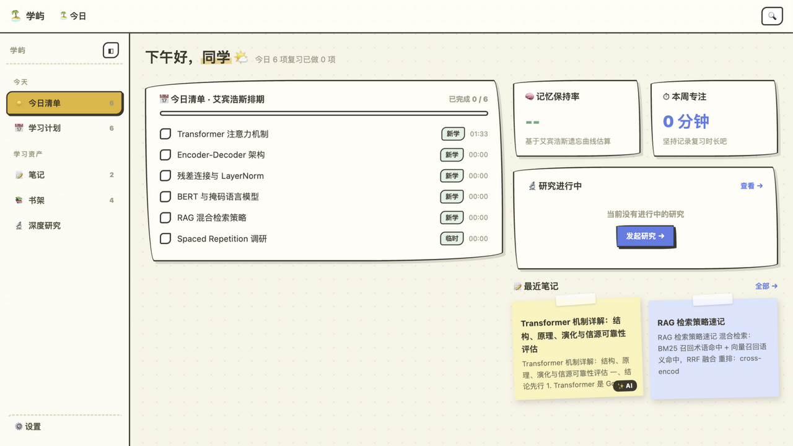
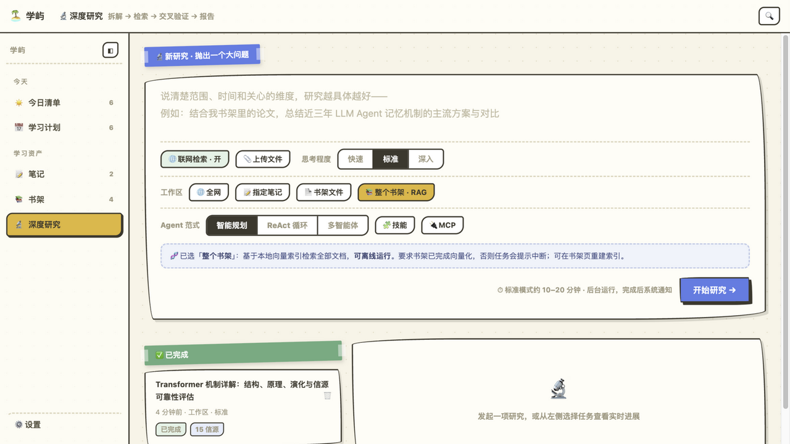
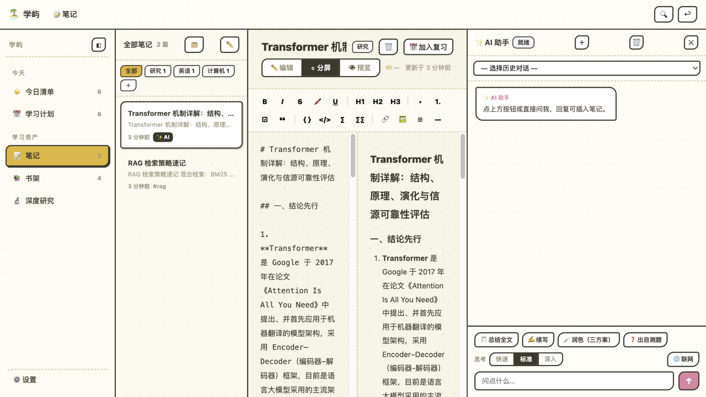
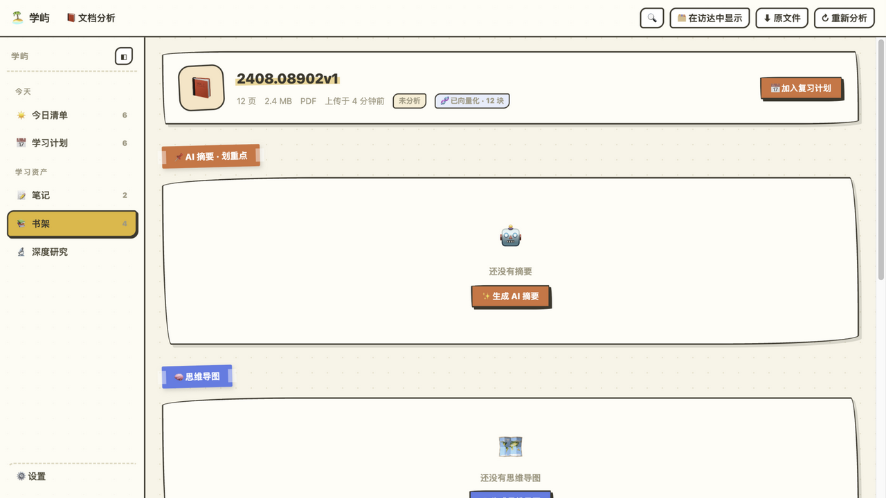
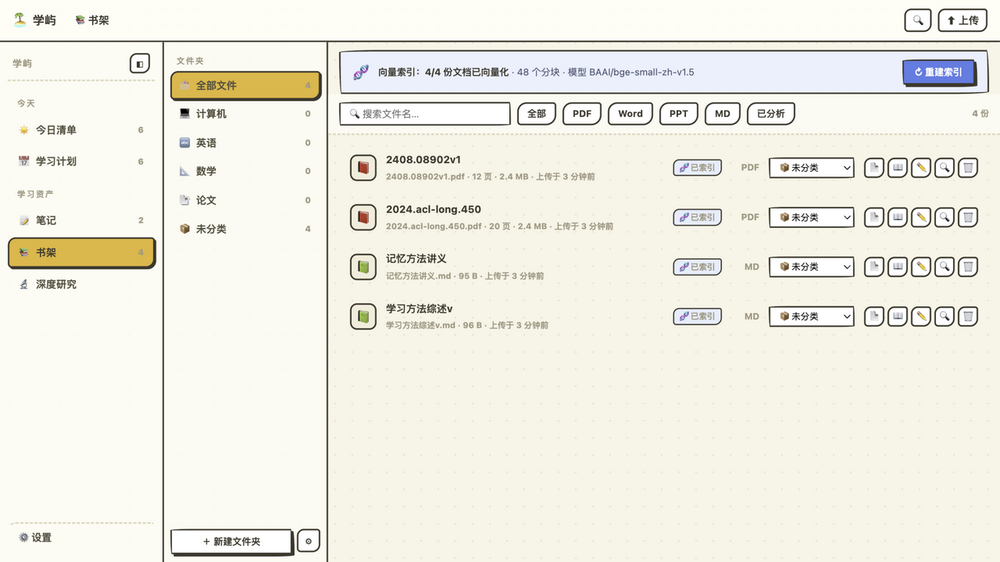
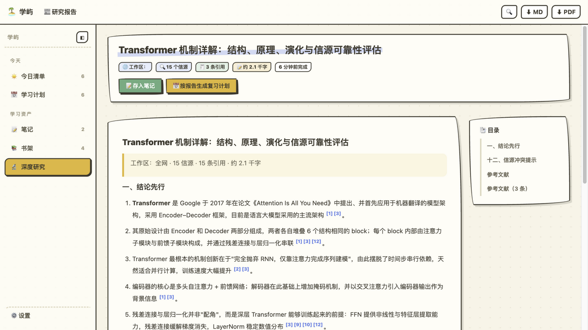
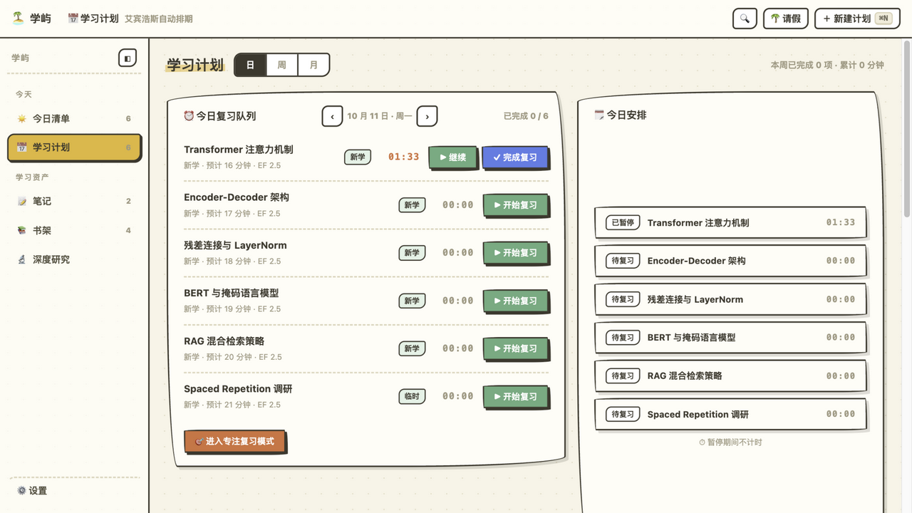
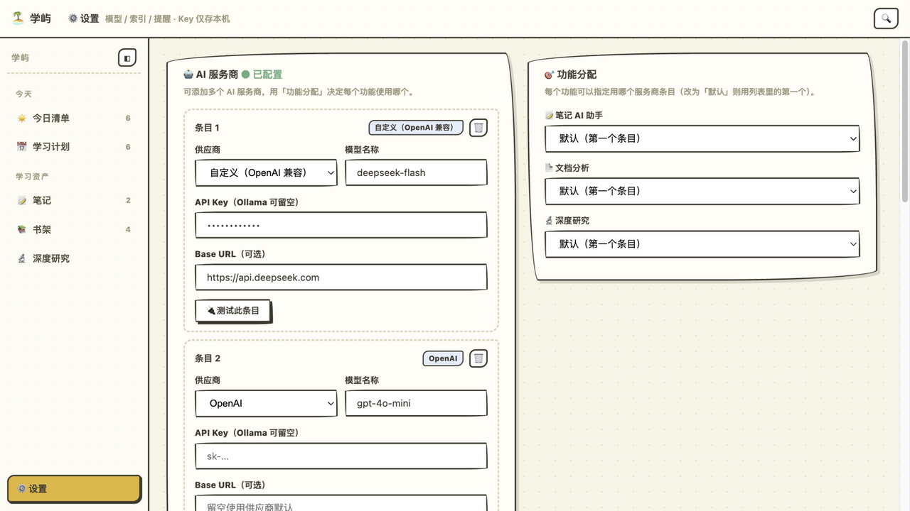
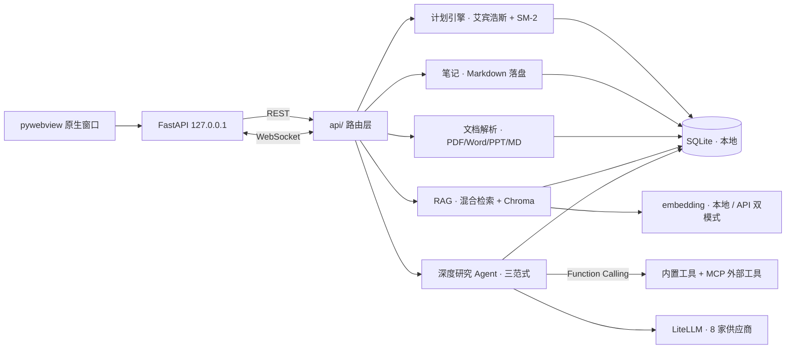

<div align="center">


# 学屿 XueYu

**一份课件传进来，一套复习计划排出来；一个调研问题问进来，一份可溯源的报告发出来。**


一个基于 AI Agent 与 RAG 的学习助手：  
文档知识库、深度研究、AI 笔记、艾宾浩斯复习计划四大能力闭环，  
所有数据保存在你自己的电脑上——无账号、无云端。

[下载 macOS 客户端](#打包为-macos-应用) · [源码运行](#-快速开始) · [架构设计](#-架构)

</div>

---

## ✨ 核心能力

### 🔬 深度研究 Agent

输入一个调研问题，Agent 自动完成「问题拆解 → 多源检索 → 交叉验证 → 报告生成」，  
产出上万字、**句句带引用**的报告。三种可切换范式：智能规划 / ReAct 工具循环 / 多智能体并行，  
支持通过 MCP 协议接入外部工具。

### 📚 文档知识库（RAG）

上传 PDF / Word / PPT / Markdown，自动解析、分块向量化入库。  
就着资料直接提问，回答**标注引用位置、可回查原文**；  
混合检索（BM25 + 向量 + RRF）保证术语和口语提问都能命中。

### 📅 艾宾浩斯复习引擎

AI 总结的考点、生成的复习卡片可一键按遗忘曲线排入每日复习清单；  
按答题正确率以 SM-2 变体动态调整间隔；全屏专注模式 + 服务端权威计时。

### 📝 AI 笔记

Markdown 编辑与渲染预览双栏实时联动；总结 / 续写 / 润色（一次三种风格）/ 出题等 AI 能力；  
多轮会话持久化，超长对话自动压缩。

<div align="center">

## 🖼️ 界面预览

| 今日总览 · 复习调度 | 深度研究 · Agent 活动日志 |
| :---: | :---: |
|  |  |
| **AI 笔记 · 实时渲染** | **文档分析 · 摘要/导图/自测** |
|  |  |
| **书架 · 文件夹式管理** | **研究报告 · 引用溯源** |
|  |  |
| **学习计划 · 三视图** | **多供应商设置** |
|  |  |

</div>

## 🔍 检索管线与 Agent 工程

<details>

<summary><b>展开技术细节</b></summary>

**混合检索**——单一向量检索对专业术语召回差、纯关键词检索对口语提问召回差：

```
用户提问 ──► Multi-Query 改写（LLM 生成多视角检索式，并行召回）
        ├─► BM25 关键词召回 ─┐
        └─► 向量语义召回 ────┤
                             ▼
                       RRF 融合排序
                             ▼
                  LLM 重排（按相关性精排，可开关）
```

**多范式编排**——单范式失败自动降级，不卡死：

| 范式       | 流程                                               | 适用    |
| -------- | ------------------------------------------------ | ----- |
| 智能规划     | 拆解 → 检索 → 覆盖度评估（不足自动补检）→ 交叉验证 → 报告               | 复杂课题  |
| ReAct 循环 | LLM 通过 Function Calling 自主调用 6+ 工具（联网/读网页/查库/记忆） | 单文档深读 |
| 多智能体     | 多个子 Agent 并行检索汇总                                 | 大规模调研 |

**其他工程细节**：自研零依赖 MCP stdio 客户端（握手/工具发现/工具调用）、  
基于向量相似度的语义缓存、按模型上下文窗口的对话自动压缩、  
检索式任务记忆、生成结果强制引用溯源 + 信源冲突并列标注。

</details>

## 🚀 快速开始

### 源码运行

```bash
git clone https://github.com/herbertgu-yep/xueyu.git
cd xueyu
./scripts/run_dev.sh          # 自动建虚拟环境、装依赖、起服务
# 浏览器打开 http://127.0.0.1:8765
```

> 首次使用在「设置」中配置模型（OpenAI / Claude / DeepSeek / 通义 / GLM / Kimi / Ollama 均可），  
> API Key 只保存在本机。

### 打包为 macOS 应用

```bash
./scripts/build_mac.sh        # 产出 dist/学屿.app 与 学屿-<版本>.dmg
```

## 🏗️ 架构



## 📂 数据与隐私

全部数据保存在本地数据目录，无任何云端依赖：

| 内容    | 位置                                |
| ----- | --------------------------------- |
| 业务数据库 | `<数据目录>/xueyu.db`                 |
| 笔记    | `<数据目录>/notes/**.md`（Obsidian 兼容） |
| 文档与索引 | `<数据目录>/docs/`、`chroma/`          |
| 研究报告  | `<数据目录>/reports/`                 |

开发模式在仓库 `./data`；打包客户端在 `~/Library/Application Support/学屿`；可用环境变量 `XUEYU_DATA` 自定义。整目录拷走即完成备份。

欢迎 PR 与 Issue。

## 📄 License

[MIT](LICENSE)
